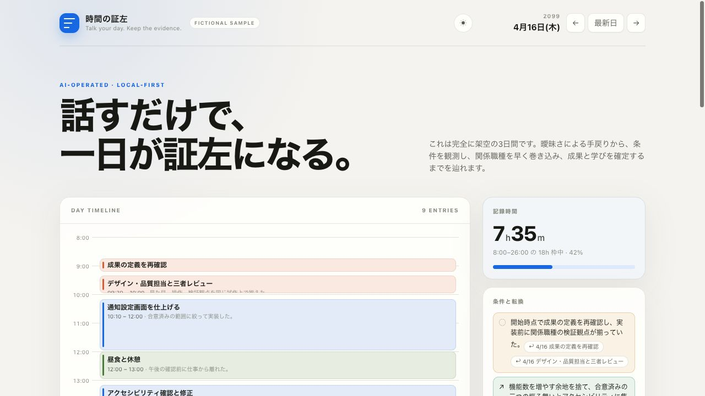

# 時間の証左

> 話すだけで、一日が証左になる。<br>
> Talk your day. Keep the evidence.

**時間の証左**は、AI-operated, local-first daily evidence log です。ユーザーはチャットで「何をしていたか」「何が効いたか」「何を変えたか」を報告するだけ。AI が一次情報を構造化し、検証し、依存ゼロの `index.html` を生成します。

公開デモは、リポジトリの About 欄にある **Homepage** から開けます。

このリポジトリには、完全に架空のプロダクトエンジニアによる連続3日間のサンプルが入っています。曖昧な要件で手戻りした初日から、条件を観測して進め方を変え、関係職種を早く巻き込んで成果と学びを確定するまでを、小さな物語として読めます。



## タイムトラッカーや日記と何が違うか

タイムトラッカーが「何分使ったか」を、日記が「どう感じたか」を中心にするのに対し、時間の証左は両方をあとから判断に使える一次情報として残します。時刻だけでなく、パフォーマンス条件、転換、損失、継続中のテーマ、目標、会議へ持ち込む論点、日常を破る体験までを同じ参照関係で結びます。

入力フォームや分析ダッシュボードは意図的に置いていません。チャットが入力経路、テキストファイルが正本、AI が構造化・生成・検証を担います。解釈を固定する分析画面より、あとから別の問いで読み直せる記録を優先しています。

## 10の証左 / Evidence Primitives

| 記法 | 記録するもの |
|---|---|
| `e` | 時間エントリ |
| `c` | パフォーマンス条件 |
| `d` | 決断・転換 |
| `h` | 日を跨ぐ学び |
| `s` | つまずき・損失 |
| `n` | 進行中の物語 |
| `g` | 月次目標 |
| `a` | スクラムイベントへの持ち込み議題 |
| `r` | 日常を破る体験・ご褒美 |
| `rs` | 体験による追加ご褒美の相殺履歴 |

技術文書では総称を **Evidence Primitives**、チャットでは **10の証左** と呼びます。各 Primitive の引数と運用規約は [`AGENTS.md`](AGENTS.md) にあります。

## ローカルファースト

生成物は CSS・データ・JavaScript を内包した単一 HTML です。ブラウザ側に通信処理はなく、CDN、フォント配信、解析タグ、API を利用しません。`index.html` を `file://` で開いても動き、そのまま1ファイルで配布できます。

アプリ自体は記録を外部送信しません。ただし、記録を更新する AI の実行環境やチャットサービスのデータ取り扱いは別です。個人データを扱う場合は、利用する AI 環境のプライバシー条件も確認してください。

## 必要環境とコマンド

Node.js 18 以上だけが必要です。npm パッケージのインストールは不要です。

```sh
npm run validate  # データ形式・refs・不変条件を検証
npm run build     # src/ と data/ から index.html を再生成
npm test          # 生成決定性・物語・プライバシー境界をテスト
npm run verify    # CI と同じ一括検証
npm run preview   # http://127.0.0.1:43128 でローカル確認
```

最初に `index.html` を直接開くか、`npm run preview` を実行してください。サンプル最新日の画面が表示されます。

## AIへの報告例

```text
9:20から10:00まで、依頼主と提案資料のたたき台を確認した。
作り込む前に、相手が重視する点とこちらの想定のずれに気づけた。午後の作業に入る前に方向を直せたので、大きな手戻りを避けられた。
完成度を上げてから見せる進め方をやめて、たたき台の段階で合意を取る方針に切り替えた。この転換も決断として残して。参照先は、今の時間ログにして。
```

AI はこの報告を `e(...)` と `d(...)` に分け、refs を実在するログタイトルへ合わせ、`npm run validate` と `npm run build` を実行します。運用時は推測を事実として断定せず、曖昧さを note に残すのが基本です。

## データ構造と主要ファイル

```text
data/
  context.js        # c / d / h / s / n / g / a / r / rs
  logs/YYYY-MM.js   # e: 月別の時間ログ
src/
  data-model.js     # 10個のコンストラクタとカテゴリ
  template.html     # 単一HTMLの骨格
  styles.css        # light / dark対応の表示
  app.js            # タイムラインと参照ジャンプ
scripts/
  build.mjs         # index.html生成
  validate.mjs      # データ検証CLI
tests/              # 架空データを使った不変条件テスト
index.html           # 生成済み・単体配布可能
```

正本は `src/` と `data/` です。`index.html` は直接編集せず、必ず `npm run build` で再生成します。設計理由と障害時の挙動は [`DESIGN.md`](DESIGN.md) を参照してください。

## 公開時の注意

このテンプレートを自分用にしたあと、個人データを public リポジトリへコミットしないでください。時間ログだけでなく、氏名、案件名、生活、体調、感情、金銭、メールアドレス、絶対パス、トークン、生成済み `index.html` も確認対象です。公開用サンプルと個人用データは、リポジトリごと分ける運用を推奨します。

このプロジェクトは experimental です。互換性、継続保守、問い合わせ対応を含むサポート保証はありません。

## License

[MIT](LICENSE)
